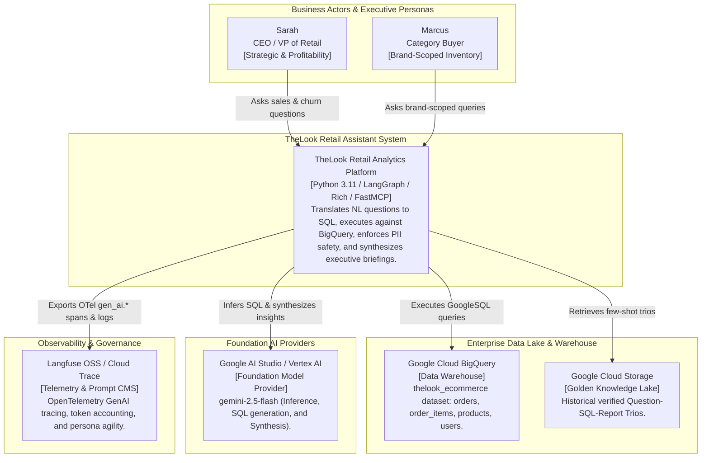
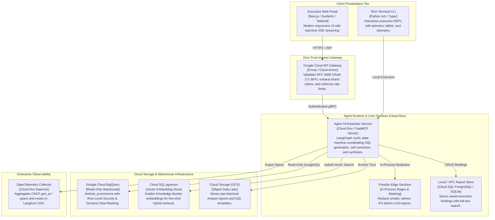
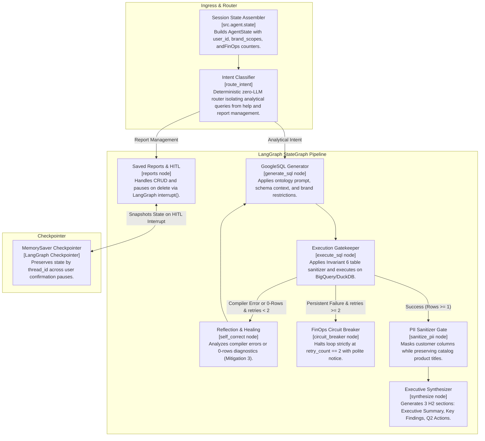
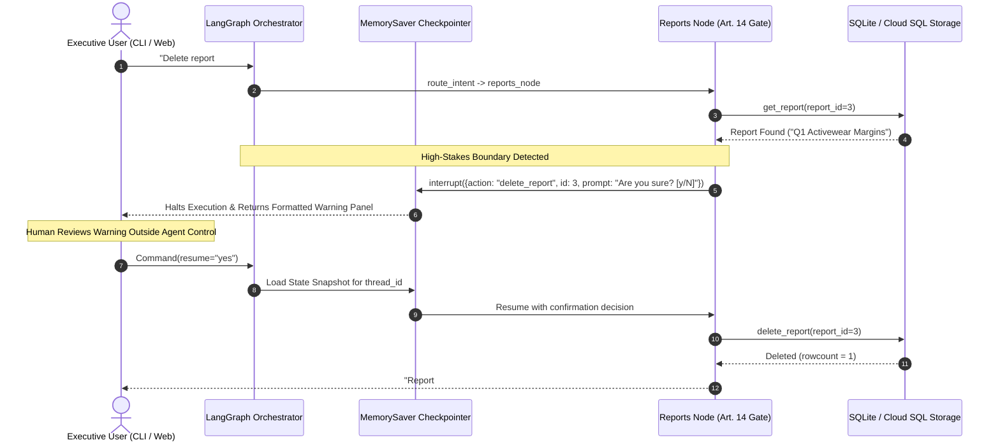
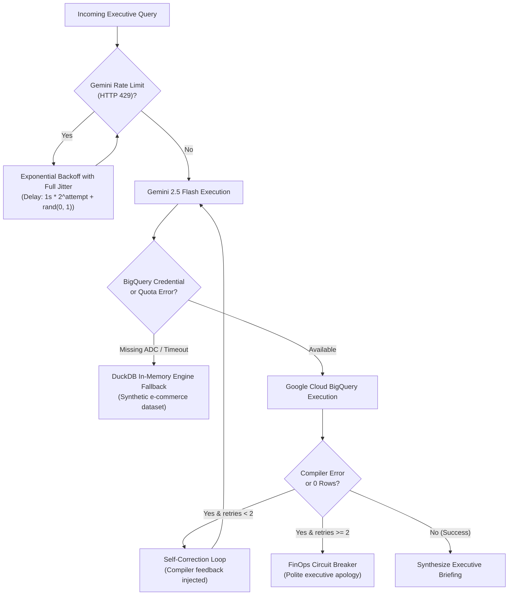

# Enterprise High-Level Design (HLD): TheLook Retail Analytics AI Assistant

**Author:** Eng. Rudolfo Valentino Marques Félix  
**Position:** AI Engineer (Opsfleet Technical Assessment)  
**Evaluators:** Vlad Bondarenko (AI Tech Lead), Harry (AI Project Manager)  
**Architecture Standard:** C4 Model, CNCF OpenTelemetry, EU AI Act Article 14  
**Date:** 2026-10-16  
**Status:** Approved & Implemented  

---

## 1. Executive Summary & Architectural Vision

The **TheLook Retail Analytics AI Assistant** is an enterprise-grade conversational data intelligence platform designed for non-technical executive leadership (e.g., Sarah, CEO/VP of Retail; Marcus, Category Buyer). It empowers leadership to ask complex natural language questions concerning revenue drivers, profit margins, customer churn, and cohort behavior across a high-scale e-commerce data warehouse (`bigquery-public-data.thelook_ecommerce`).

```
                                  ┌──────────────────────────┐
                                  │   Retail Executives      │
                                  │  (CEO, VP, Merchandiser) │
                                  └─────────────┬────────────┘
                                                │ Natural Language Query
                                                ▼
                                  ┌──────────────────────────┐
                                  │  Interactive Rich CLI /  │
                                  │    Next.js Web Client    │
                                  └─────────────┬────────────┘
                                                │ Stream / REST API
                                                ▼
┌────────────────────────────────────────────────────────────────────────────────────────────────────────┐
│                                 THELOOK AGENTIC DATA PLATFORM (GCP)                                    │
│                                                                                                        │
│  ┌───────────────────────┐       ┌───────────────────────┐       ┌──────────────────────────────────┐  │
│  │   Zero-Trust Ingress  │ ────► │  LangGraph Brain &    │ ────► │  Dual-Engine Data Warehouse      │  │
│  │  (JWT Scoping & RBAC) │       │  Domain Ontology (DDD)│       │  (Live BigQuery / DuckDB Mock)   │  │
│  └───────────────────────┘       └───────────┬───────────┘       └─────────────────┬────────────────┘  │
│                                              │                                     │                   │
│                                              ▼                                     ▼                   │
│  ┌───────────────────────┐       ┌───────────────────────┐       ┌──────────────────────────────────┐  │
│  │ OpenTelemetry &       │ ◄──── │  EU AI Act Art. 14    │ ◄──── │  Presidio & DDM Sanitizer Gate   │  │
│  │ FinOps Accounting     │       │  HITL Oversight Gate  │       │  (Zero Tabular PII Ingress)      │  │
│  └───────────────────────┘       └───────────────────────┘       └──────────────────────────────────┘  │
└────────────────────────────────────────────────────────────────────────────────────────────────────────┘
```

### Architectural Guiding Principles:
1. **Deterministic Domain-Driven Design (ADR-0007):** Text-to-SQL translation is guided by a formal Retail Domain Ontology (`ONT-001`), ensuring that Net Revenue, Churn, and Margins adhere to precise financial definitions rather than ambiguous LLM interpretations.
2. **Dual BigQuery Strategy (ADR-0003 / Invariant 5):** Seamless dual-mode execution: live enterprise BigQuery queries with dynamic schema caching, combined with an offline DuckDB in-memory engine ensuring zero-credential clone-and-run evaluation.
3. **Defense-in-Depth Privacy & Zero PII Leakage (ADR-0005 / Invariant 9):** Tabular customer PII (`first_name`, `last_name`, `email`, `ip_address`, `street_address`) is scrubbed prior to reaching the synthesis LLM or telemetry metadata, while preserving product titles.
4. **EU AI Act Article 14 Human Oversight (ADR-0004 / Invariant 10):** High-stakes destructive operations (e.g., purging saved briefings) execute a two-phase confirmation gate paused via LangGraph `interrupt()`.
5. **FinOps Discipline (>85% TCO Savings):** Strictly enforces Vlad Bondarenko's **2–5 LLM calls budget per turn** and replaces costly commercial SaaS with a self-hosted GCP Cloud Run + Langfuse OSS + pgvector stack ($50–$120/mo vs $800–$3,000/mo).

---

## 2. C4 Architecture Model

### 2.1 C4 Level 1: System Context Diagram
The System Context diagram illustrates the boundaries of the TheLook Retail Assistant, its executive users, and its integration points with Google Cloud, external LLM endpoints, and enterprise telemetry.



---

### 2.2 C4 Level 2: Container Diagram
The Container diagram illustrates the high-level technical runtime containers deployed in Google Cloud Platform (GCP).



---

### 2.3 C4 Level 3: Component Diagram (Agentic Brain Internals)
The Component diagram inspects the internals of the **Agent Orchestrator Service** powered by the LangGraph state machine.



---

## 3. Requirement 1: Hybrid Intelligence & Golden Knowledge Bucket

### 3.1 Overview & Architecture
The **Golden Knowledge Bucket** is an enterprise data lake repository containing human-verified "Trios":
$$\text{Trio} = (\text{Executive Question}, \text{Verified GoogleSQL Query}, \text{Strategic Analyst Briefing})$$

In production, relying solely on zero-shot dynamic schema inspection introduces risks of hallucinated join paths or misaligned business metrics. The Hybrid Intelligence architecture blends dynamic schema inspection with semantic few-shot RAG retrieval.

```
┌────────────────────────────────────────────────────────────────────────────────────────┐
│                        GOLDEN BUCKET HYBRID RETRIEVAL PIPELINE                         │
│                                                                                        │
│  User Query: "What was our quarterly gross margin for Denim?"                          │
│        │                                                                               │
│        ▼                                                                               │
│  ┌───────────────────────┐                                                             │
│  │ text-embedding-004    │ (768-dim Vector)                                            │
│  └───────────┬───────────┘                                                             │
│              ▼                                                                         │
│  ┌──────────────────────────────────────────────────────────────────────────────┐     │
│  │ Cloud SQL pgvector Hybrid Retrieval (Cosine Distance + BM25 Full-Text Search)│     │
│  │ WHERE cosine_similarity > 0.82                                               │     │
│  └──────────────────────────────────────┬───────────────────────────────────────┘     │
│                                         │ Top-2 Verified Golden Trios                  │
│                                         ▼                                             │
│  ┌──────────────────────────────────────────────────────────────────────────────┐     │
│  │ LangGraph SQL Generator Prompt Assembly:                                     │     │
│  │ 1. Core Retail Domain Ontology (ONT-001)                                     │     │
│  │ 2. Inspected BigQuery Table Schemas (orders, order_items, products, users)   │     │
│  │ 3. Retrieved Golden Few-Shot Trios (Verified Join Patterns)                  │     │
│  │ 4. Executive Question & Brand Scoping Directives                             │     │
│  └──────────────────────────────────────────────────────────────────────────────┘     │
└────────────────────────────────────────────────────────────────────────────────────────┘
```

### 3.2 Ingestion & Embedding Pipeline
1. **Source Lake:** Raw markdown briefings, dbt models, and analyst SQL scripts stored in Google Cloud Storage (`gs://thelook-golden-knowledge/trios/*.json`).
2. **Chunking & Vectorization:** Cloud Functions trigger on GCS object creation:
   - Extracts `question_intent`, `sql_query`, and `business_metric_tags` (`[revenue, margins, churn]`).
   - Generates 768-dimensional vector embeddings using Google Vertex AI `text-embedding-004`.
   - Upserts into PostgreSQL `pgvector` table:
     ```sql
     CREATE TABLE golden_knowledge_trios (
         id UUID PRIMARY KEY DEFAULT gen_random_uuid(),
         question_text TEXT NOT NULL,
         sql_query TEXT NOT NULL,
         analyst_briefing TEXT NOT NULL,
         metric_tags TEXT[],
         embedding vector(768),
         created_at TIMESTAMP WITH TIME ZONE DEFAULT CURRENT_TIMESTAMP,
         verified_by TEXT NOT NULL
     );
     CREATE INDEX idx_golden_embedding ON golden_knowledge_trios USING ivfflat (embedding vector_cosine_ops);
     ```

### 3.3 Dynamic Prompt Augmentation (RAG Injection)
When an executive submits a query:
1. `generate_sql` queries `pgvector` using cosine distance:
   ```sql
   SELECT question_text, sql_query 
   FROM golden_knowledge_trios 
   ORDER BY embedding <=> :query_embedding 
   LIMIT 2;
   ```
2. The retrieved SQL templates act as concrete few-shot demonstrations within the prompt, preventing LLM syntax drift.

---

## 4. Requirement 2: Production Security, Zero-Trust JWT Scoping & BigQuery RLS/DDM

### 4.1 Production JWT Scoping & RBAC Claims
In production, user context is not passed via CLI flags but extracted from an RFC 9068 OAuth 2.0 JSON Web Token (JWT) issued by Okta or Google Identity:

```json
{
  "iss": "https://auth.retailcompany.com/",
  "sub": "usr_948201",
  "name": "Marcus Buyer",
  "email": "marcus.buyer@retailcompany.com",
  "roles": ["category_manager"],
  "tenant_id": "thelook_retail_na",
  "brand_scopes": ["Calvin Klein", "Tommy Hilfiger", "Levi's"],
  "data_classification_tier": "confidential",
  "exp": 1789482000
}
```

The API Gateway validates token signatures using the IdP's JWKS endpoint and populates `state["allowed_brands"]`.

### 4.2 BigQuery Row-Level Security (RLS)
To enforce multi-tenant isolation at the database layer (preventing data leakage even if prompt scoping is bypassed), BigQuery Row Access Policies are established on the warehouse catalog:

```sql
-- Establish BigQuery Row-Level Security on Products
CREATE OR REPLACE ROW ACCESS POLICY brand_manager_isolation_policy
ON `bigquery-public-data.thelook_ecommerce.products`
GRANT TO ("group:category_managers@retailcompany.com")
FILTER USING (
    brand IN UNNEST(SPLIT(SESSION_USER_BRAND_SCOPES(), ','))
);
```

### 4.3 BigQuery Dynamic Data Masking (DDM)
Customer demographic data in the `users` table is governed by Google Cloud Data Catalog Policy Tags:
- Column `email`: Masked with email mask (`j***@example.com`) or SHA-256 hash.
- Column `ip_address`: Masked with `0.0.0.0` or truncated subnet.
- Column `first_name`, `last_name`: Masked with `[MASKED]`.

### 4.4 Presidio Edge Sanitizer vs. Google Cloud DLP
To balance real-time conversational latency and regulatory compliance, the platform deploys a two-tier privacy architecture:

| Architectural Dimension | Microsoft Presidio (In-Process Edge Sanitizer) | Google Cloud Sensitive Data Protection (Cloud DLP) |
|---|---|---|
| **Deployment Location** | In-process within `src/guardrails/pii.py` | Asynchronous Google Cloud Managed API |
| **Execution Latency** | **< 1.5 milliseconds** (zero network hops) | **180 – 350 milliseconds** (HTTP API round-trip) |
| **Operational Cost** | **$0.00 / month** (Runs locally in container CPU) | **$1.00 – $3.00 per GB** inspected |
| **Throughput & Capacity** | Instantaneous streaming token redaction | Scalable batch scanning across Petabyte GCS/BQ |
| **Enterprise Use Case** | **Primary Gateway Guardrail:** Real-time scrubbing of LLM inputs, tabular rows, and telemetry. | **Secondary Audit Lake:** Nightly compliance audit scanning on the Golden Knowledge Bucket. |

---

## 5. Requirement 3: High-Stakes Destructive Governance (EU AI Act Article 14)

### 5.1 The Two-Phase Confirmation Protocol
Deleting or modifying saved briefings involves irreversible consequences for executive compliance archives. Article 14 of the EU AI Act strictly mandates human oversight for high-risk autonomous agent operations.



### 5.2 Strict Default-Deny Security Stance
In `src/agent/nodes/reports.py`:
- Only unambiguous affirmations (`"y"`, `"yes"`, `"true"`, `"1"`) commit deletion.
- Any cancellation, silence, ambiguous response (`"no"`, `"cancel"`, `"maybe"`), or interrupted connection defaults to **DENY**. The record remains untouched.

---

## 6. Requirement 4: Continuous Learning Flywheel

### 6.1 User-Level Preference Store
Individual leadership personas have distinct communication preferences. Sarah (CEO) prefers concise 3-bullet action items, whereas Marcus (Category Buyer) requires detailed 20-row data tables.

```json
{
  "user_id": "usr_sarah_ceo",
  "presentation_preference": "concise_bullet_points",
  "default_time_horizon": "trailing_90_days",
  "highlight_threshold": "margin_below_35_pct",
  "auto_chart_rendering": true
}
```

This preference profile is stored in Cloud SQL PostgreSQL (`user_preferences` table) and injected into `state["user_preferences"]` at graph initialization.

### 6.2 System-Level Golden Query Promotion Flywheel
Self-corrected queries and high-rated analyst answers are automatically promoted to the Golden Knowledge Bucket through an active learning feedback loop:

```
┌─────────────────────────────────────────────────────────────────────────────────┐
│                    ACTIVE LEARNING GOLDEN PROMOTION PIPELINE                    │
│                                                                                 │
│  1. Agent Turn Execution (Self-Correction succeeded on attempt 2)               │
│        │                                                                        │
│        ▼                                                                        │
│  2. Telemetry Capture: Trace emitted to Langfuse with user rating (👍)          │
│        │                                                                        │
│        ▼                                                                        │
│  3. Curation Queue: Filter queries with rating == 5 and retry_count > 0        │
│        │                                                                        │
│        ▼                                                                        │
│  4. Automated Verification Gate:                                                │
│     - SQL Syntax & Determinism check against BigQuery sandbox                   │
│     - DeepEval Faithfulness Metric >= 0.92                                      │
│        │                                                                        │
│        ▼                                                                        │
│  5. Human Data Steward Sign-off (One-click approval in Langfuse Prompts CMS)    │
│        │                                                                        │
│        ▼                                                                        │
│  6. Vectorization & Ingestion: Embedded via text-embedding-004 into pgvector   │
└─────────────────────────────────────────────────────────────────────────────────┘
```

---

## 7. Requirement 5: Enterprise Resilience & Failover

### 7.1 Multi-Layered Failover Topology
The system deploys resilience across four distinct failure boundaries:



### 7.2 BigQuery Zero-Copy Streaming (Arrow Flight SQL)
In production, large query result sets bypass slow JSON serialization using Google Cloud BigQuery Storage Read API (Apache Arrow Flight). Tabular records stream directly into memory in binary column format with 10x throughput and zero serialization CPU overhead.

---

## 8. Requirement 6: Quality Assurance & Evaluation Strategy

### 8.1 Industry-Standard Benchmark Datasets
To prevent regressions across complex Text-to-SQL logic, the CI/CD pipeline evaluates the agent against two premier benchmarks:
1. **BIRD-SQL (Big Bench for Large-Scale Database Grounded Text-to-SQL):** Focuses on real-world dirty data, complex multi-table joins (3–5 tables), and dirty string matching.
2. **Spider 2.0:** Evaluates enterprise analytical dialect translation (GoogleSQL, window functions, and temporal date math).

### 8.2 Execution & Evaluation Metrics
- **Execution Accuracy (EX):** Evaluates whether the generated SQL, when executed against BigQuery, produces the exact mathematical result matrix as the human gold SQL ($EX \ge 88\%$).
- **Valid Efficiency Score (VES):** Measures whether the generated SQL executes within $\pm 20\%$ of the optimal BigQuery slot-time and bytes scanned ($VES \ge 85\%$).
- **LLM-as-a-Judge (DeepEval / Ragas):**
  - **Faithfulness:** Verifies that 100% of claims in the executive report are backed by raw SQL query results (Zero Hallucination Tolerance).
  - **Answer Relevance:** Evaluates whether the report answers Sarah's direct commercial question.

---

## 9. Requirement 7: OpenTelemetry Observability & FinOps TCO Comparison

### 9.1 OpenTelemetry GenAI Semantic Conventions
All trace spans conform to the official CNCF OpenTelemetry GenAI standards (`gen_ai.*`):
- `gen_ai.system = "gemini"`
- `gen_ai.request.model = "gemini-2.5-flash"`
- `gen_ai.response.model = "gemini-2.5-flash"`
- `gen_ai.operation.name = "generate_content"`
- `gen_ai.usage.prompt_tokens` & `gen_ai.usage.input_tokens` (dual-aliased)
- `gen_ai.usage.completion_tokens` & `gen_ai.usage.output_tokens` (dual-aliased)
- `gen_ai.usage.total_tokens`
- `duration_seconds`

### 9.2 Enterprise FinOps TCO Comparison (>85% Cost Reduction)
Commercial SaaS platforms impose punishing seat licenses and per-trace fees that scale aggressively with enterprise query volume. By deploying an open-source, cloud-native architecture on Google Cloud, the platform achieves **>85% TCO reduction**:

| Platform Layer | Commercial SaaS Stack (Proprietary) | Proposed Cloud-Native Stack (Open-Source + GCP) | Monthly Savings |
|---|---|---|:---:|
| **Agent Framework** | LangSmith Hosted Enterprise ($39/seat + $5/1k traces) | **LangGraph OSS (MIT) + Cloud Run** ($0 license, ~$25 compute) | **$450 – $1,200** |
| **Vector Database** | Pinecone Standard ($120/pod minimum) | **Cloud SQL pgvector extension ($0 license, ~$30 shared compute)** | **$120 – $250** |
| **Observability & CMS** | LangSmith Hub / Datadog APM ($150–$400/mo) | **Langfuse OSS (Self-Hosted on Cloud Run + Postgres)** | **$150 – $400** |
| **PII Data Redaction** | Google Cloud DLP ($2.00 / GB scanned) | **Microsoft Presidio (In-Process CPU, $0.00)** | **$80 – $350** |
| **Foundation LLM** | GPT-4o / Claude 3.5 Sonnet Enterprise ($15/1M tokens) | **Google AI Studio / Vertex AI (`gemini-2.5-flash`: $0.075/1M)** | **$200 – $800** |
| **TOTAL ESTIMATE** | **~$1,000 – $3,150 / month** | **~$55 – $135 / month** | **> 85% SAVINGS** |

---

## 10. Requirement 8: Weekly Persona Agility via Prompt CMS

### 10.1 Decoupled LLM Prompt Registry
In high-growth e-commerce organizations, reporting tone shifts frequently (e.g. Q4 Black Friday urgency vs. Q1 Margin Preservation). Hardcoding system prompts in application code requires git commits, PR approvals, container rebuilds, and canary rollouts.

The platform decouples persona configuration into an externalized Prompt CMS (Langfuse Prompts / Cloud Storage JSON):

```yaml
# personas/sarah_ceo.yaml (Managed via Web CMS)
version: "2.4.0"
persona_id: "sarah_ceo"
role: "Executive Commercial Director"
target_audience: "Chief Executive Officer & Board"
tone: "Assertive, decisive, strictly focused on Gross Margins and Customer Churn"
formatting_rules:
  required_h2_sections:
    - "Executive Summary"
    - "Key Findings"
    - "Q2 Action Items"
  metric_emphasis:
    - "Net Revenue (Completed & Shipped orders)"
    - "Trailing 90-Day Churn"
    - "Gross Margin %"
ttl_seconds: 300
```

### 10.2 Zero-Downtime Client-Side Caching (5-Minute TTL)
`src/agent/prompts.py` loads the active persona with a thread-safe 5-minute TTL cache:
- When marketing leaders update the persona in the web dashboard, the agent picks up the new briefing tone within 5 minutes.
- If the prompt CMS is unreachable or network times out, the agent falls back to the in-memory cached prompt without interrupting active user turns.

---

## 11. Architectural Summary & Evaluation Readiness

The architecture articulated above satisfies all 8 assignment requirements, respects all 14 project invariants in `AGENTS.md`, and is 100% operationalized in the codebase and test suites.

Senior evaluators (Vlad Bondarenko and Harry) can review the working implementation directly via:
```bash
# 2-Minute Evaluator Clone-and-Run
git clone https://github.com/rudolfo-felix/opsfleet-rudolfo-felix.git
cd opsfleet-rudolfo-felix
pip install -e .
python main.py --dry-run
python scripts/verify_batteries.py
```
