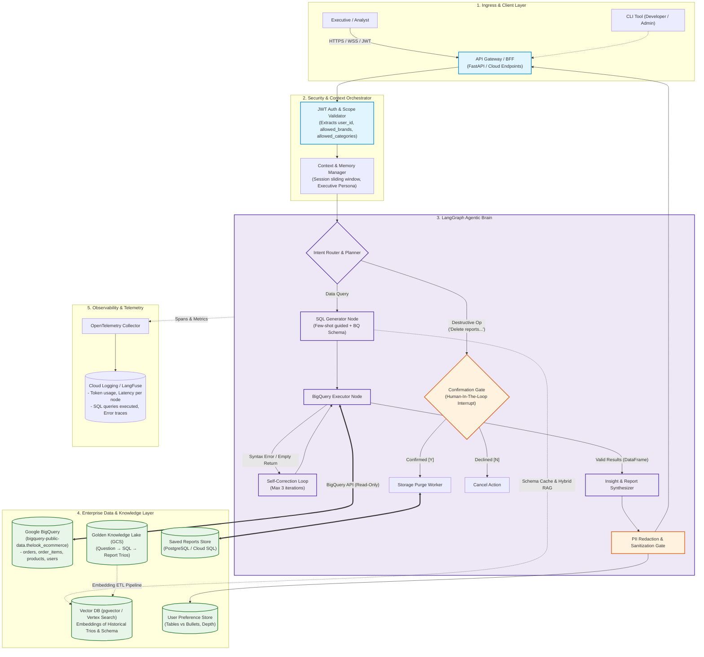
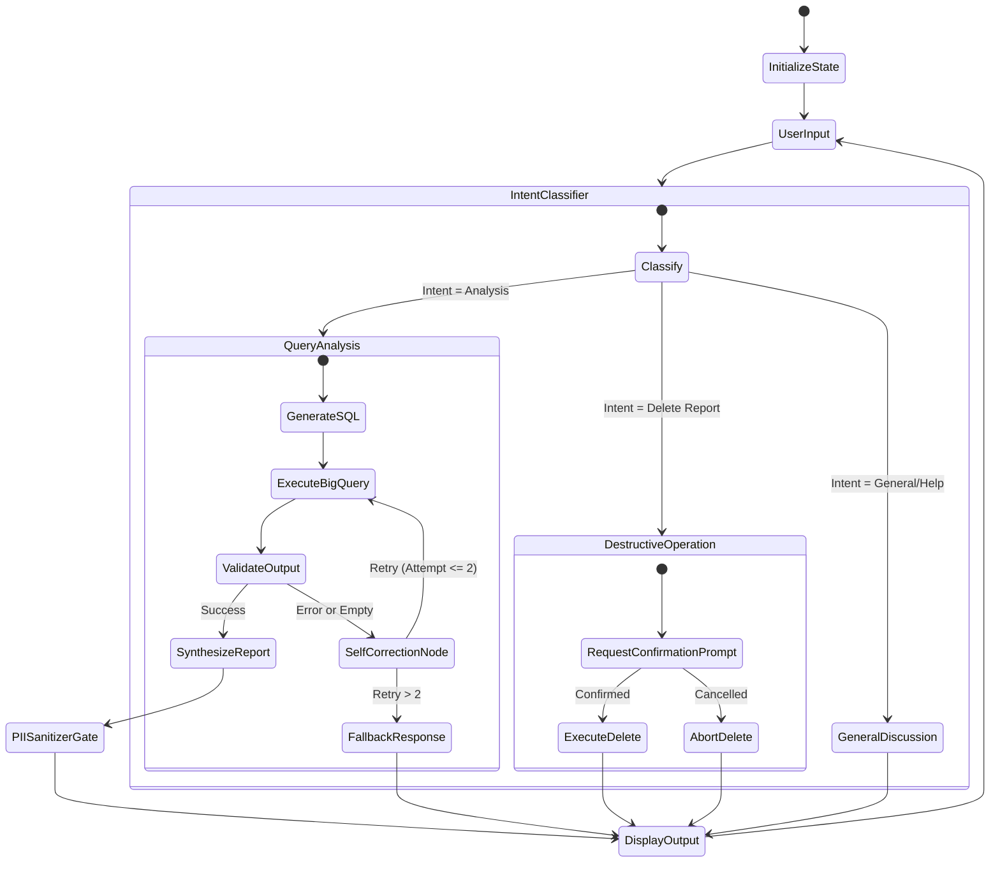

# Opsfleet AI Technical Assessment: Master Execution Plan & Blueprint

**Candidate:** Eng. Rudolfo Valentino Marques Félix  
**Position:** AI Engineer (Opsfleet)  
**Evaluation Stage:** Stage 2 — Technical Assessment (1-Week Window | 6–12 Hours Execution)  
**Deliverable:** Public GitHub Repository (Architecture Diagram, Detailed Technical Documentation, Runnable CLI Working Prototype)  
**Slack Channel:** `#t-ai-rudolfo-félix`  
**Team & Key Contacts:**  
- **Vlad Bondarenko** — AI Tech Lead (Engineering Reviewer)  
- **Emilija Milevska Nikodinoska** — Talent Acquisition  
- **Harry** — Project Manager (Opsfleet AI Assistant Agent)  
- **Candidate Profile:** Rudolfo Félix

---

## 🔗 0. Official Document & Workspace Links

Here are the direct links to all the original materials, canvases, and environment resources provided for this assessment:

* 📄 **Official Assignment Canvas (Slack Doc):**  
  AI Technical Assignment - Retail Company (Opsfleet Candidate Canvas)  
  * 💬 **Candidate Slack Channel:**  
  Opsfleet Assignment Collaboration Channel (#t-ai-rudolfo-félix)
* 🗄️ **Target BigQuery Dataset:**  
  `bigquery-public-data.thelook_ecommerce`  
  *(Public tables: `orders`, `order_items`, `products`, `users`)*
* 🤖 **LLM Provider API Portal:**  
  [Google AI Studio](https://aistudio.google.com/) *(Free tier for `gemini-1.5-flash` / `gemini-1.5-pro`)*
* 📚 **Core Architectural Reference (Whitepaper in Repo):**  
  [The Agentic Operating Model (LangChain Enterprise Whitepaper)](The%20Agentic%20Operating%20Model.pdf)  
  *Key concepts: Agent Development Lifecycle (ADLC), Risk Taxonomy (Tier 2 HITL), LangGraph Runtimes, Context Hubs, and FinOps.*
* 💼 **Opsfleet Company Overview:**  
  [Opsfleet Website](https://opsfleet.com) | Headquarters: Israel | 60+ Engineers (AI, Data, DevOps)

---

## 📌 1. Executive Summary & Company Context

### About Opsfleet
* **Mission:** Opsfleet does not build simple "LLM wrappers"; they design and deploy production-grade, stateful, autonomous **Multi-Agent Systems (MAS)**.
* **Core Frameworks & Tools:** LangChain, **LangGraph**, Agno, Strands, ADK, **Model Context Protocol (MCP)**, Agent-to-Agent (A2A), GCP Vertex AI / Gemini, and AWS Bedrock.
* **Hiring Pipeline:**
  1. HR Screen *(Completed)*
  2. **Technical Assessment** *(Current Stage — 1-week turnaround, 6–12h work expectation)*
  3. Tech Interview *(Deep dive into this solution)*
  4. Meeting with Head of AI & Data

---

## 🎯 2. The Challenge: Retail Data Analysis Chat Assistant

### Business Objective
Design and build a data analysis assistant for a Retail Company’s non-technical executive teams (Opsfleet is the client; Team Lead + Harry are the PMs). 

Executives need to ask complex sales and performance questions naturally, such as:
- *"Why are users in State X underspending compared to State Y?"*
- *"Why did our churn rate spike last month?"*
- *"Create a report for Q1 including insights and action items for Q2."*

### Available Data & Assets:
1. **The Database (Read-Only):** Public Google Cloud BigQuery dataset: `bigquery-public-data.thelook_ecommerce`.
   - `orders`: Order ID, user ID, status, timestamps, item counts.
   - `order_items`: Line items, product IDs, sale prices, status.
   - `products`: Product ID, cost, retail price, department, category, brand.
   - `users`: User demographic data (ID, name, email, street address, state, IP — **Contains PII**).
2. **The "Golden Knowledge" Bucket (Theoretical):** A data lake of historical "Trios" (*Question $\rightarrow$ SQL Query $\rightarrow$ Analyst Report*) created by human experts.

---

## 💬 3. Slack Technical Alignment & Q&A (Sanity Checks)

Before writing code, we performed a proactive alignment in the official Opsfleet Slack channel. The questions and the authoritative answers provided by **Harry (AI Project Manager Agent)** established the exact scope boundaries:

### Verbatim Slack Q&A:

| # | Topic | Question Asked | Official Answer (Harry / Opsfleet) |
|---|---|---|---|
| **1** | **User Context & Scoping (CLI Prototype)** | *For PII masking and product scoping ("users can only analyze products related to them"), is it acceptable to simulate the active user via a CLI flag or initial session prompt (e.g., `--user-id 123` or mock executive selector)?* | **Approved.** *"Yes, simulating the active user via a CLI flag or initial session prompt is perfectly fine for the prototype. In a production setup the agent would receive a JWT with the user's brand scopes from the frontend — just describe that flow in the HLD."* |
| **2** | **Golden Knowledge Bucket** | *The spec notes the Golden Bucket is theoretical. Can we fully specify its ingestion, embedding, and retrieval loop in the HLD, while keeping the prototype on dynamic BigQuery schema exploration (optionally seeded with 2–3 mock trios)?* | **Approved.** *"Your plan is well-aligned. The bucket is a design requirement — fully specifying ingestion, embedding, and retrieval in the HLD is the expectation. Seeding the prototype with 2–3 local mock few-shots is a nice touch and welcome, but not required."* |
| **3** | **Saved Reports Persistence** | *For destructive ops & confirmation flows ("Delete reports mentioning X"), is a lightweight local storage (SQLite or JSON) sufficient for the prototype?* | **Approved.** *"Yes, a local SQLite file or in-memory/JSON store is completely sufficient for the prototype. Cover the intended production persistence approach in your technical explanation."* |
| **4** | **Tooling, Framework & Rate Limits** | *Planning to use Google AI Studio (gemini-1.5-flash / pro) with LangGraph and GCP ADC for BigQuery. Any constraints?* | **Approved with Critical Tip.** *"LangGraph is a fine choice... Gemini (via Google AI Studio) is the preferred model provider, and gemini-1.5-flash / pro fits well. **Keep LLM calls per query low (roughly 2–5) to stay within free-tier rate limits.**"* |

---

## ⚖️ 4. Strict Scope Boundary: Design (HLD) vs. Prototype (Code)

To achieve maximum quality within the 6–12 hour budget and prevent over-engineering, requirements are divided strictly according to the assignment specification (Page 2, Section 3):

```
┌────────────────────────────────────────────────────────────────────────┐
│                        REQUIREMENTS BREAKDOWN                          │
├─────────────────────────────────────┬──────────────────────────────────┤
│ 📐 COVERED IN HLD & DOCS ONLY       │ 💻 IMPLEMENTED IN WORKING CODE   │
├─────────────────────────────────────┼──────────────────────────────────┤
│ 1. Production Golden Bucket RAG ETL │ 1. Safety & PII Masking          │
│ 2. Production JWT Scoping / RBAC    │ 2. High-Stakes Oversight (Delete)│
│ 3. Continuous Learning (User/System)│ 3. Resilience & Error Auto-Fix   │
│ 4. Weekly Persona Agility (No-code) │ 4. Observability & Tracing       │
│ 5. Full Quality Assurance Strategy  │ 5. BigQuery SQL Execution (Live) │
│ 6. Multi-Tenant Enterprise Cloud    │ 6. CLI-based Conversational UI   │
└─────────────────────────────────────┴──────────────────────────────────┘
```

---

## 🏗️ 5. High-Level Design (HLD) Blueprint

The HLD must be comprehensive, enterprise-ready, and production-grade.

### System Architecture Diagram (Mermaid)



---

## 💻 6. Prototype Architecture & Implementation Blueprint

### Stack Selection (Approved by Opsfleet)
* **Language:** Python 3.11+
* **LLM Engine:** Google Gemini 1.5 Flash (`gemini-1.5-flash`) via `google-genai` / `langchain-google-genai`
* **Orchestration:** `LangGraph` (StateGraph with checkpointer / memory)
* **Data Warehouse:** `google-cloud-bigquery` client (`bigquery-public-data.thelook_ecommerce`)
* **Local Persistence:** SQLite (`reports.db`) for the Saved Reports library and audit logs
* **CLI UX:** `rich` for elegant executive tables, syntax highlighting, and progress spinners

### LangGraph State Machine Specification



---

## 🏛️ 6.1 Architectural Alignment: The Agentic Operating Model (AOM)

Our design directly applies the principles established in LangChain's enterprise whitepaper, *[The Agentic Operating Model](The%20Agentic%20Operating%20Model.pdf)*, mapping Opsfleet's assessment requirements to industry-standard patterns:

| Opsfleet Requirement | AOM Architectural Concept | Concrete Design / Prototype Implementation |
|---|---|---|
| **High-Stakes Oversight (Destructive Ops)** | **Agentic Risk Taxonomy (Tier 2: Actuating)** | Classified as a consequential action. Implemented using **Human-In-The-Loop (HITL) Checkpoints via LangGraph interrupts (`interrupt()`)** where state execution halts durably until explicit user approval. |
| **Safety & PII Masking** | **LLM Gateway / Policy Engine** | Centralized input/output enforcement boundary. Redacts customer PII (emails, names, IP addresses) before responses exit the agent boundary. |
| **Resilience & Self-Correction** | **Durable Graph Runtime & Loops** | Replaces brittle linear chains with a **LangGraph StateGraph**. When BigQuery yields syntax/empty errors, the graph loops back to a self-correction node with a hard retry budget ($\le 2$) to protect FinOps economics. |
| **Agility / Persona Management (CEO Tone)** | **Context Hub / Prompt as an Artifact** | Decouples prompts and persona definitions from application code into an externalized, environment-tagged repository, enabling non-technical stakeholders to iterate on tone without redeploying code. |
| **Quality Assurance & Observability** | **Agent Development Lifecycle (ADLC) & Trajectory Evals** | Moves beyond traditional unit tests into **Golden Datasets, Trajectory Testing, and Token Attribution Tracing**, measuring accuracy, latency, and cost-per-correct-interaction. |

---

## 📅 7. Step-by-Step Implementation Roadmap (6–12 Hours)

| Phase | Milestone | Estimated Time | Key Deliverables |
|:---:|---|:---:|---|
| **Phase 1** | **Repository & Environment Scaffolding** | 1.0 h | Directory layout, `requirements.txt`, `.env.example`, GCP ADC setup. |
| **Phase 2** | **BigQuery & Schema Integration** | 1.5 h | `bq_client.py` connecting to `thelook_ecommerce`, schema metadata extractor. |
| **Phase 3** | **LangGraph Agent & Self-Correction** | 2.5 h | StateGraph setup, SQL generator, BigQuery runner node, self-correction loop. |
| **Phase 4** | **PII Masking & Scoping Guardrails** | 1.5 h | User scoping injection, post-processing regex/sanitizer filter. |
| **Phase 5** | **Saved Reports & Destructive Confirmation** | 1.5 h | SQLite report store, human-in-the-loop confirmation flow. |
| **Phase 6** | **CLI User Interface & Observability** | 1.5 h | `rich` interactive chat interface, telemetry logger, session metrics panel. |
| **Phase 7** | **HLD & Documentation Suite** | 2.5 h | `docs/HLD.md` with full Mermaid diagram and comprehensive coverage of all 8 production requirements. |
| **Total** | | **~11.5 h** | Fully verified, tested, and ready for public GitHub submission. |

---

## 📂 8. Repository Structure

```text
retail-data-agent/
├── docs/
│   ├── HLD.md                  # Complete High-Level Design (8 Production Requirements)
│   ├── ARCHITECTURE.png        # Rendered Mermaid architecture diagram
│   └── EVALUATION_STRATEGY.md  # Continuous improvement and QA testing strategy
├── src/
│   ├── __init__.py
│   ├── config.py               # Settings, API keys, BigQuery dataset IDs
│   ├── agent/
│   │   ├── __init__.py
│   │   ├── state.py            # LangGraph TypedDict state
│   │   ├── graph.py            # Complete LangGraph StateMachine
│   │   └── prompts.py          # System prompts, few-shot examples, persona configs
│   ├── bq/
│   │   ├── __init__.py
│   │   ├── client.py           # BigQueryRunner wrapper (thelook_ecommerce)
│   │   └── schema.py           # Cached schema definitions for table awareness
│   ├── guardrails/
│   │   ├── __init__.py
│   │   ├── pii.py              # PII detection & masking utilities
│   │   └── scope.py            # User-level product/brand scoping filters
│   ├── storage/
│   │   ├── __init__.py
│   │   └── reports.py          # SQLite repository for Saved Reports management
│   └── telemetry/
│       ├── __init__.py
│       └── tracer.py           # Structured logging and token/latency instrumentation
├── tests/
│   ├── test_sql_generation.py  # Unit tests with BigQuery mocks
│   ├── test_pii_masking.py     # PII filter assertion tests
│   └── test_destructive_ops.py # Confirmation flow assertion tests
├── .env.example
├── main.py                     # CLI Entrypoint (Interactive session)
├── README.md                   # Setup instructions, architecture overview, design decisions
└── requirements.txt
```

---

## ✅ 9. Master Deliverables & Verification Checklist

Use this checklist to track progress throughout the assignment:

### A. Environment & Cloud Pre-requisites
- [ ] Google AI Studio API Key generated (`GEMINI_API_KEY`).
- [ ] GCP authentication active with BigQuery read access (`gcloud auth application-default login`).
- [ ] Virtual environment initialized (`python -m venv .venv`).
- [ ] Dependencies installed via `requirements.txt`.

### B. High-Level Design (HLD) Documentation (`docs/HLD.md`)
- [ ] **Deliverable 1 (Diagram):** Complete Mermaid architecture diagram showing ingress, agentic core, data lake, storage, and telemetry.
- [ ] **Deliverable 2a (Cloud & Framework Reasoning):** Justification for LangGraph, Google Gemini, BigQuery, and GCP/AWS components.
- [ ] **Deliverable 2b (Data Flow):** End-to-end trace from user query to SQL execution, synthesis, and response.
- [ ] **Deliverable 2c (Error Handling & Fallbacks):** Explanation of circuit breakers, rate limit strategies, and self-correction.
- [ ] **Requirement 1 (Hybrid Intelligence):** Specification of the Golden Knowledge Bucket (GCS/S3) ingestion, chunking, vector embedding, and retrieval loop.
- [ ] **Requirement 2 (Production Security & PII):** JWT claims validation, RBAC brand/category scoping, and runtime data redaction.
- [ ] **Requirement 3 (High-Stakes Destructive Ops):** Two-phase commit / confirmation flow specification for saved report purges.
- [ ] **Requirement 4 (Continuous Improvement):** Design of the User-level preference store (bullet vs table) and System-level reinforcement loop.
- [ ] **Requirement 5 (Resilience & Error Handling):** Enterprise failover, caching, and rate-limit mitigation strategies.
- [ ] **Requirement 6 (Quality Assurance & Evals):** Evals framework (RAGAS / Golden Dataset), hallucination benchmarks, and UX evaluation strategy.
- [ ] **Requirement 7 (Observability):** OpenTelemetry span definitions, token cost metrics, and deep-dive debugging dashboards.
- [ ] **Requirement 8 (Agility / Persona Management):** No-code persona configuration system allowing executives/CEO to adjust tone weekly without redeployments.

### C. Working Prototype Implementation (`src/`)
- [ ] **CLI Conversational Interface (`src/cli.py` & `main.py`):** Interactive chat loop using `rich` supporting natural language exploration.
- [ ] **BigQuery Integration (`src/bq/client.py`):** Dynamic SQL query generation and execution on `bigquery-public-data.thelook_ecommerce`.
- [ ] **LangGraph State Machine (`src/agent/graph.py`):** Multi-node graph coordinating planning, SQL generation, execution, and synthesis.
- [ ] **Resilience Loop (`self_correction` node):** Automatic syntax/empty result detection and prompt-based self-healing (max 2 retries).
- [ ] **Safety & PII Masking (`src/guardrails/pii.py`):** Runtime sanitization preventing email, name, or IP output from the `users` table.
- [ ] **Row-Level Product Scoping (`src/guardrails/scope.py`):** Simulation via CLI flag/session (`--user-id` or executive department filter).
- [ ] **High-Stakes Oversight (`src/storage/reports.py`):** Interactive confirmation flow before deleting saved reports.
- [ ] **Observability & Tracing (`src/telemetry/tracer.py`):** Execution logging of latency, SQL queries, and LLM call counts (staying within the 2–5 call budget).

### D. Setup & Packaging Quality
- [ ] Clean `.env.example` file provided.
- [ ] `README.md` includes clear, reproducible setup and example run commands.
- [ ] Unit tests passing in `tests/`.
- [ ] Public GitHub repository created and accessible.
- [ ] Submission link posted in `#t-ai-rudolfo-félix` Slack channel.
