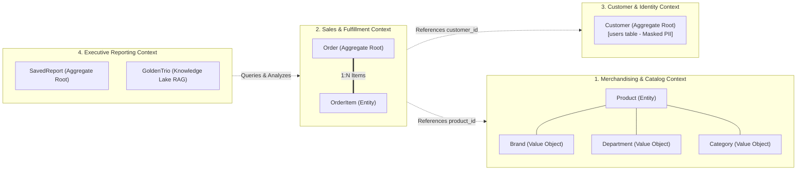

# Domain-Driven Design (DDD): Retail Business Ontology & Ubiquitous Language

* **Document ID:** ONT-001
* **Status:** Approved / Active
* **Domain:** Retail E-Commerce Analytics (`bigquery-public-data.thelook_ecommerce`)
* **Target Audience:** AI Engineers, Data Analysts, Executive Stakeholders

---

## 🎯 1. Executive Summary & The "Semantic Gap" Problem

In natural language data analysis, **90% of Text-to-SQL failures stem from domain ambiguity rather than SQL syntax errors**. 
When an executive asks:
* *"What was our revenue last quarter?"*
* *"Why did customer churn spike in California?"*
* *"Which brands produce the highest profit margins?"*

A naive LLM connecting directly to raw database tables faces severe semantic gaps:
1. **The Dataset has no `churn` column:** In `thelook_ecommerce`, churn is a temporal business concept that must be derived from transaction frequency.
2. **The "Revenue" Ambiguity:** Does revenue include cancelled or returned items? If an agent sums all `order_items.sale_price` without checking `status NOT IN ('Cancelled', 'Returned')`, it inflates numbers and destroys executive trust.
3. **The "Margin" Ambiguity:** Calculating margins requires accurately joining `order_items` with `products` on `product_id` and computing `(sale_price - cost)`.

By establishing a **Formal Business Ontology and Ubiquitous Language (Domain-Driven Design - Eric Evans)**, we construct a deterministic semantic layer that is injected into the LangGraph agent's context, eliminating hallucinated business logic.

---

## 📖 2. Master Ubiquitous Language & Acronym Glossary Table

This table forms the shared vocabulary between retail executives, data engineers, and the AI Assistant.

| Acronym / Term | Domain | Canonical Business Definition | Technical Implementation in BigQuery (`thelook_ecommerce`) |
|---|---|---|---|
| **GMV** | Retail | **Gross Merchandise Value:** Total gross transactional dollar value processed before cancellations and returns. | `SUM(order_items.sale_price)` across all orders. |
| **Net Revenue** | Retail | **Realized Sales:** Revenue from completed or shipped transactions, strictly excluding cancellations and returns. | `SUM(order_items.sale_price) WHERE status NOT IN ('Cancelled', 'Returned')` |
| **Gross Margin** | Retail | **Profit Contribution:** Dollar difference between selling price and unit acquisition cost. | `SUM(order_items.sale_price - products.cost)` (requires join on `product_id`). |
| **Gross Margin %** | Retail | **Margin Percentage:** Profit contribution as a percentage of selling price. | `SAFE_DIVIDE(SUM(order_items.sale_price - products.cost), SUM(order_items.sale_price)) * 100` |
| **AOV** | Retail | **Average Order Value:** Average net revenue generated per distinct finalized order. | `SAFE_DIVIDE(Net Revenue, COUNT(DISTINCT order_items.order_id))` |
| **Return Rate %** | Retail | **Product Rejection Ratio:** Percentage of sold items returned by customers. | `SAFE_DIVIDE(COUNTIF(status = 'Returned'), COUNTIF(status IN ('Complete', 'Shipped', 'Returned'))) * 100` |
| **Churned User** | Retail | **Customer Attrition:** A registered customer who placed at least one order historically but has zero orders in the trailing 90 days. | Subquery: `MAX(orders.created_at) < TIMESTAMP_SUB(CURRENT_TIMESTAMP(), INTERVAL 90 DAY)` |
| **LTV** | Retail | **Customer Lifetime Value:** Cumulative net revenue generated by an individual customer across their history. | `SUM(sale_price)` grouped by `user_id` where `status NOT IN ('Cancelled', 'Returned')` |
| **SKU / Product** | Retail | **Stock Keeping Unit:** Unique product identifier within catalog dimensions. | `products.id`, categorized by `department`, `category`, and `brand`. |
| **HITL** | AI Governance | **Human-In-The-Loop:** Mandatory pause for explicit human confirmation on high-stakes operations (EU AI Act Art. 14). | LangGraph `interrupt()` gate triggered before `DELETE FROM reports`. |
| **RLS / DDM** | Security | **Row-Level Security & Dynamic Data Masking:** Data-layer enforcement of brand scoping and PII masking. | BigQuery evaluation order: 1º RLS (`WHERE brand IN (...)`), 2º DDM (`SHA-256(email)`). |
| **EX / VES** | AI QA | **Execution Accuracy & Valid Efficiency Score:** Text-to-SQL evaluation benchmarks from Spider & BIRD-SQL. | EX evaluates DataFrame equivalence; VES penalizes full-table scan query latency. |
| **MCP** | AI Protocol | **Model Context Protocol:** Open standard for connecting agents to external databases and resources. | Exposes Golden Bucket trios as `golden-trios://retail/queries`. |
| **OTel / OTLP** | Observability | **OpenTelemetry Protocol:** CNCF standard for distributed tracing and GenAI semantic conventions. | Standardized tracking via `gen_ai.*` namespaces (`gen_ai.usage.input_tokens`). |

---

## 🏛️ 3. Domain-Driven Design (DDD) Bounded Contexts

The retail data platform is divided into four distinct **Bounded Contexts**:



### Context 1: Merchandising & Catalog
* **Aggregate Root:** `Product`
* **Invariants:** Every product must belong to exactly one `Department` (e.g., `Men`, `Women`), one `Category`, and one `Brand`.
* **Cost Invariant:** `retail_price` must always be $\ge$ `cost`.

### Context 2: Sales & Fulfillment
* **Aggregate Root:** `Order`
* **Entities:** `OrderItem` (line items).
* **Order Status State Machine:**
  $$\text{Processing} \longrightarrow \text{Shipped} \longrightarrow \text{Complete}$$
  $$\text{Processing} \longrightarrow \text{Cancelled}$$
  $$\text{Complete} \longrightarrow \text{Returned}$$
* **Invariant:** An order's total items count (`num_of_item`) must match the count of associated `order_items`.

### Context 3: Customer & Identity (GDPR Protected)
* **Aggregate Root:** `Customer` (mapped to `thelook_ecommerce.users`).
* **Governance Boundary:** All customer attributes (`first_name`, `last_name`, `email`, `ip_address`) are classified as **Confidential PII** and subject to automatic masking before reaching analytical consumers.

### Context 4: Executive Reporting & Insights
* **Aggregate Root:** `SavedReport` (persisted in SQLite locally, Cloud SQL in production).
* **Knowledge Lake Entity:** `GoldenTrio` (*Natural Question $\rightarrow$ Verified GoogleSQL $\rightarrow$ Executive Markdown Report*).

---

## 📋 4. Canonical Entity Catalog

| Canonical Entity | Source Table in BigQuery | Business Purpose | Key Attributes | Sensitivity / Governance |
|---|---|---|---|---|
| **`Order`** | `thelook_ecommerce.orders` | Represents the transactional cart purchase by a customer. | `order_id`, `user_id`, `status`, `gender`, `created_at`, `num_of_item` | Internal Commercial |
| **`OrderItem`** | `thelook_ecommerce.order_items` | Individual line item purchased, including actual sale price and tracking status. | `id`, `order_id`, `user_id`, `product_id`, `status`, `sale_price` | Internal Commercial |
| **`Product`** | `thelook_ecommerce.products` | Master catalog dimension representing goods available for retail. | `id`, `cost`, `category`, `name`, `brand`, `retail_price`, `department` | Public / Scoped by Brand |
| **`Customer`** | `thelook_ecommerce.users` | Demographic and account profile of retail shoppers. | `id`, `gender`, `state`, `country`, `traffic_source`, `created_at` | **RESTRICTED PII:** Names, emails, and IPs redacted. |
| **`SavedReport`** | `reports.db (SQLite)` | Curated strategic briefs saved by executives for asynchronous review. | `id`, `title`, `user_id`, `query_text`, `summary_markdown`, `created_at` | Executive Confidential (HITL Protected) |

---

## 📐 5. Deterministic Semantic Mapping Rules (Prompt Guidelines)

To eliminate ambiguity when translating natural language to SQL, the LangGraph agent prompt enforces the following deterministic translation rules:

```sql
-- 1. Net Revenue Calculation Rule:
-- When an executive asks for "Revenue", "Sales", or "Total Earned", always exclude Cancelled and Returned orders:
SELECT 
    DATE_TRUNC(created_at, MONTH) AS sales_month,
    ROUND(SUM(sale_price), 2) AS net_revenue
FROM `bigquery-public-data.thelook_ecommerce.order_items`
WHERE status NOT IN ('Cancelled', 'Returned')
GROUP BY 1
ORDER BY 1 DESC;

-- 2. Profit Margin Calculation Rule:
-- When asked for "Profit" or "Margin", join order_items with products on product_id:
SELECT 
    p.category,
    ROUND(SUM(oi.sale_price - p.cost), 2) AS gross_profit,
    ROUND(SAFE_DIVIDE(SUM(oi.sale_price - p.cost), SUM(oi.sale_price)) * 100, 2) AS margin_percentage
FROM `bigquery-public-data.thelook_ecommerce.order_items` oi
JOIN `bigquery-public-data.thelook_ecommerce.products` p ON oi.product_id = p.id
WHERE oi.status NOT IN ('Cancelled', 'Returned')
GROUP BY 1
ORDER BY gross_profit DESC;

-- 3. Customer Churn Calculation Rule:
-- When asked for "Churn" or "At-Risk Customers", evaluate trailing 90-day activity:
WITH customer_orders AS (
    SELECT 
        user_id,
        MAX(created_at) AS last_order_date
    FROM `bigquery-public-data.thelook_ecommerce.orders`
    WHERE status NOT IN ('Cancelled')
    GROUP BY user_id
)
SELECT 
    COUNTIF(last_order_date < TIMESTAMP_SUB(CURRENT_TIMESTAMP(), INTERVAL 90 DAY)) AS churned_customers,
    COUNT(user_id) AS total_customers,
    ROUND(SAFE_DIVIDE(COUNTIF(last_order_date < TIMESTAMP_SUB(CURRENT_TIMESTAMP(), INTERVAL 90 DAY)), COUNT(user_id)) * 100, 2) AS churn_rate_pct
FROM customer_orders;
```

---

## 🛡️ 6. Architectural Conclusion

Incorporating this **Domain Ontology and Ubiquitous Language**:
1. Bridges the semantic gap between non-technical C-Level questions and BigQuery columnar tables.
2. Ensures that mathematical definitions of core retail KPIs (**Net Revenue, Margin %, Churn, AOV**) remain mathematically consistent across all conversations.
3. Provides a clean foundation for the **Golden Bucket RAG** (Requirement 1) and **User Scoping** (Requirement 2).
