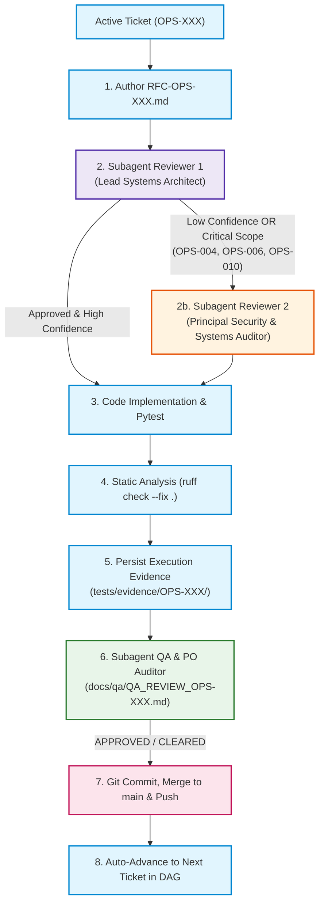

# 🐝 Autonomous Swarm Execution Protocol & Multi-Agent Governance
**Repository:** `/Users/rudy/Documents/opsfleet-rudolfo-felix`  
**Author:** AI Systems Architect & Technical Governance Lead  
**Audience:** Autonomous Coding Agents (Antigravity, Codex, Cursor)  
**Status:** Active Production Protocol  
**Date:** 2026-10-16  

---

## 1. Objective & Autonomous Mandate

This protocol establishes the **fully autonomous multi-agent execution pipeline** for delivering the **Retail Data Analysis AI Assistant** from ticket `OPS-002B` through `OPS-010`.

Under this protocol:
* The user operates as the **Ship Captain**, providing high-level permissions and vision.
* The Primary Agent operates as the **First Mate / Lead Developer**, autonomously implementing RFCs, code, tests, and git management.
* Independent subagents act as **Architectural Reviewers** and **QA/PO Auditors**, evaluating every milestone without requiring human micro-approvals.
* **Automatic Progression:** When a ticket is formally approved by the auditor subagents, the primary agent commits, merges to `main`, pushes to `origin/main`, and **automatically advances to the next ticket in the DAG**.

---

## 2. Multi-Agent Swarm Roles & Responsibilities



### Agent Roles:

1. **Primary Agent (Lead Developer / Orchestrator):**
   - Engine: Gemini 3.8 Flash (High) in Antigravity (0% Codex quota) or Codex CLI where prioritized.
   - Responsibilities: Authors RFCs, implements production code, writes hermetic unit tests, fixes lint/test failures, and orchestrates subagents.

2. **Reviewer 1 (Lead Systems Architect & RFC Auditor):**
   - Mode: Independent subagent (`typeName: research`).
   - Responsibilities: Audits `RFC-OPS-XXX.md` against acceptance criteria, invariants, and edge cases before coding starts.

3. **Reviewer 2 (Principal Security & Systems Auditor - Escalation / Critical Gate):**
   - Mode: Independent secondary subagent (`typeName: research`).
   - Trigger Criteria:
     - Reviewer 1 confidence is low (< 90%) or notes technical ambiguity.
     - **Critical Tickets:** Automatically invoked for high-complexity tickets:
       - **OPS-004:** LangGraph Cyclic Graph & Self-Correction Loop.
       - **OPS-006:** Enterprise PII Sanitizer & Multi-Tenant Brand Scoping.
       - **OPS-010:** Final 20-Battery Evaluation Runner & Production HLD.

4. **QA & PO Auditor (Lead QA & Product Owner Auditor):**
   - Mode: Independent subagent (`typeName: research`).
   - Responsibilities: Evaluates completed code, test runs (`pytest -v`), and evidence files against 100% of Acceptance Criteria, producing `docs/qa/QA_REVIEW_OPS-XXX.md`.

---

## 3. Autonomous Execution Workflow (Per Ticket)

For every ticket in the backlog:

1. **Branch Initialization:**
   ```bash
   git checkout -b feat/OPS-XXX-...
   ```
2. **RFC Specification:**
   - Author `docs/rfc/RFC-OPS-XXX.md` using Template 2.
3. **Subagent Architecture Review:**
   - Spawn Reviewer 1 (and Reviewer 2 if critical/low confidence).
   - If revisions requested: update RFC and confirm approval.
4. **Code & Test Implementation:**
   - Write source modules in `src/`.
   - Write hermetic unit tests in `tests/`.
   - Execute `.venv/bin/pytest -v`.
   - Execute `.venv/bin/ruff check --fix . && .venv/bin/ruff format .`.
5. **Evidence Persistence (Invariant 12):**
   - Save `tests/evidence/OPS-XXX/pytest_output.txt`.
   - Save `tests/evidence/OPS-XXX/ruff_output.txt`.
   - Save `tests/evidence/OPS-XXX/execution_demo.txt`.
6. **Subagent QA & PO Audit:**
   - Spawn QA & PO Auditor subagent.
   - Author `docs/qa/QA_REVIEW_OPS-XXX.md`.
7. **Commit & Delivery:**
   - Mark ticket `done` in `tickets/OPS-XXX.md` and `tickets/README.md`.
   - Commit: `OPS-XXX feat: <short summary>`.
   - Merge to `main` and push to `origin/main`.
8. **Chaining:**
   - Immediately transition to the next ticket without stopping.

---

## 4. Emergency Halt Conditions

The Primary Agent must run continuously without stopping unless one of the following fatal external blockers occurs:
1. Missing external secrets or credentials that cannot be generated or mocked.
2. Unrecoverable hardware or network partition lasting > 10 minutes.
All normal software engineering challenges (failing tests, linter warnings, dialect syntax bugs) MUST be resolved autonomously using self-healing loops.
