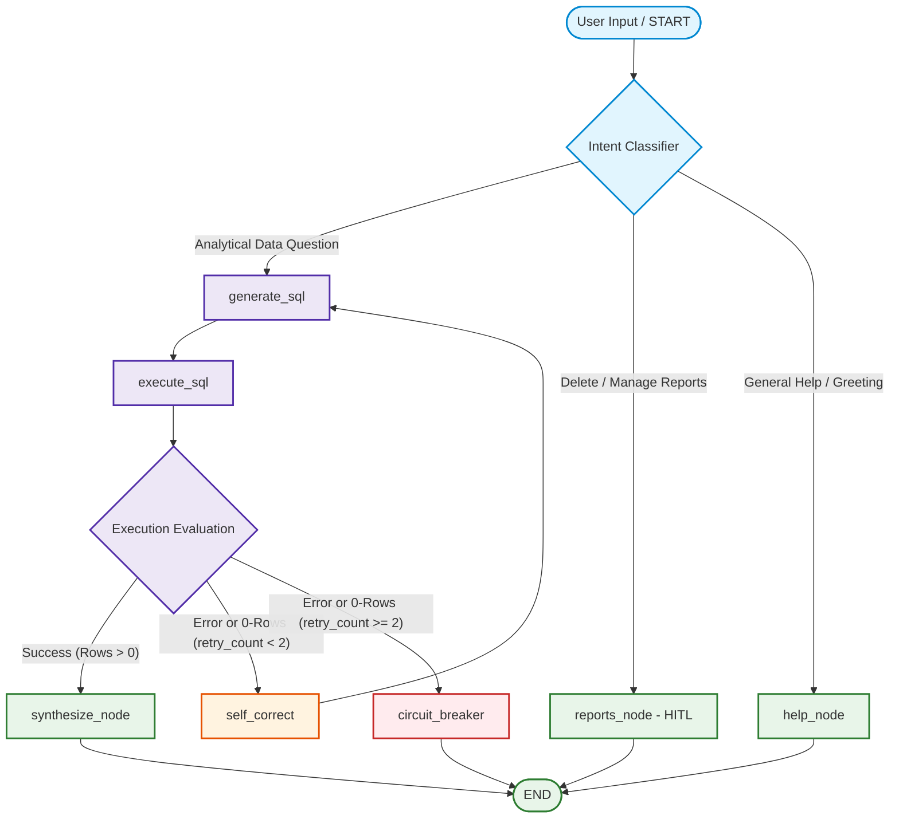

# RFC: OPS-004 - SQL Execution Node, Self-Correction Reflection Loop & FinOps Circuit Breaker

**Related Ticket:** [OPS-004](../../tickets/OPS-004-sql-execution-and-self-correction.md)  
**General Runbook:** [Autonomous Swarm Protocol](../architecture/AUTONOMOUS_SWARM_PROTOCOL.md)
**Architectural References:** [ADR-0001](../adr/0001-adopt-langgraph-state-machine.md), Invariant 4 (FinOps 2-5 Call Budget), Invariant 11 (Self-Correction Loop <= 2 Retries), Mitigation 3 (0-Rows Corrective Feedback)

---

## 1. Executive Summary & Problem Statement

This RFC specifies the architecture and implementation for:
1. The **SQL Execution Node** (`src/agent/nodes/execute_sql.py`) executing generated GoogleSQL queries against BigQuery (or the in-memory DuckDB fallback via `get_bigquery_client()`).
2. The **Self-Correction Reflection Node** (`src/agent/nodes/self_correct.py`) and cyclical reflection loop in LangGraph.
3. The **0-Rows Diagnostic Feedback Engine** (Mitigation 3) diagnosing empty result sets caused by status casing or date interval mismatches.
4. The **FinOps Circuit Breaker** capping retries strictly at $\le 2$ attempts to guarantee zero infinite loops and prevent API quota exhaustion.
5. The complete **LangGraph StateGraph Assembler** (`src/agent/graph.py`) with entrypoint Intent Classification routing.

---

## 2. Technical Specification & Architecture

### 2.1 Cyclic Graph Workflow Architecture

---

### 2.2 Intent Classifier Routing (`route_intent`)

At graph entrypoint, an intent classifier inspects `state["user_query"]`:
- **Report Management / Deletion:** Patterns like `delete report`, `remove report`, `saved reports`, `clear report` $\rightarrow$ routes to `reports_node` (OPS-007 HITL).
- **General Help / Greeting:** `help`, `what can you do`, `hello`, `hi` $\rightarrow$ routes to `help_node`.
- **Analytical Data Queries:** All other queries targeting sales, revenue, products, customers $\rightarrow$ routes to `generate_sql`.

---

### 2.3 SQL Execution Node (`src/agent/nodes/execute_sql.py`)

1. Retrieves client via `get_bigquery_client()` (handling live BigQuery or DuckDB fallback).
2. Executes `state["current_sql"]` via `client.query_to_dicts(sql)`.
3. Evaluates execution results:
   - **Case A: Rows returned ($\ge 1$):**
     - Sets `state["query_results"] = records`
     - Sets `state["error_feedback"] = None`
   - **Case B: Query compiles and runs, but returns 0 rows (Mitigation 3):**
     - If `state.get("retry_count", 0) < 2`:
       - Formulates diagnostic feedback:
         `"Query executed successfully but returned 0 rows. Common retail causes in thelook_ecommerce: 1) Status casing is title-cased ('Complete', 'Shipped', 'Cancelled', 'Returned'), not lowercase. 2) Date filters (e.g. INTERVAL 30 DAY) may be too restrictive for older dataset years. 3) Brand names are title-cased (e.g. 'Calvin Klein'). Check filters and adjust."`
       - Sets `state["error_feedback"] = diagnostic_message`
       - Sets `state["query_results"] = []`
     - Else (`retry_count >= 2`): sets `state["query_results"] = []`, `state["error_feedback"] = None`.
   - **Case C: SQL Compiler or Runtime Exception:**
     - Intercepts `BigQueryClientError`, `Exception`.
     - Formulates compiler feedback: `"BigQuery compilation/execution error: {exc}"`.
     - Sets `state["error_feedback"] = error_msg`
     - Sets `state["query_results"] = None`.

---

### 2.4 Self-Correction Node (`src/agent/nodes/self_correct.py`)

1. Increments `state["retry_count"] += 1`.
2. Preserves `error_feedback` so `generate_sql` can inject it into the prompt.
3. Logs diagnostic warning in console.

---

### 2.5 Circuit Breaker Node (`src/agent/nodes/circuit_breaker.py`)

1. Triggered when `retry_count >= 2` and query is still failing or empty.
2. Formulates clean, user-facing explanation in `state["executive_report"]`:
   `"⚠️ **Query Circuit Breaker Triggered (Max 2 Retries Reached):** Unable to resolve the analytical query after 2 self-correction attempts. Last diagnostic: {error_feedback}. FinOps call budget preserved."`
3. Halts execution cleanly without throwing raw python tracebacks.

---

### 2.6 StateGraph Assembly (`src/agent/graph.py`)

1. Assembles `StateGraph(AgentState)` with all nodes.
2. Provides lightweight stub pass-throughs for `synthesize` (OPS-005) and `reports` (OPS-007) so the graph compiles and can be invoked end-to-end.
3. Compiles graph with optional checkpointer (`MemorySaver`).

---

## 3. Execution Steps

1. **Step 1: Module `src/agent/nodes/execute_sql.py`:**
   - Query execution, 0-rows diagnostic detection, exception capture.
2. **Step 2: Module `src/agent/nodes/self_correct.py` & `circuit_breaker.py`:**
   - Retry counter management and user-facing breaker reports.
3. **Step 3: Module `src/agent/graph.py`:**
   - Intent routing, cyclic edge definition, StateGraph compilation.
4. **Step 4: Unit Tests in `tests/test_self_correction.py`:**
   - Compiler error reflection test.
   - 0-rows diagnostic reflection test.
   - Circuit breaker hard cap test ($= 2$ retries).
   - Intent classifier routing test.
5. **Step 5: Evidence & Multi-Agent Review:**
   - Generate evidence in `tests/evidence/OPS-004/`.
   - Reviewer 1 (Lead Systems Architect) and Reviewer 2 (Principal Security & Systems Auditor).
   - QA & PO sign-off.
