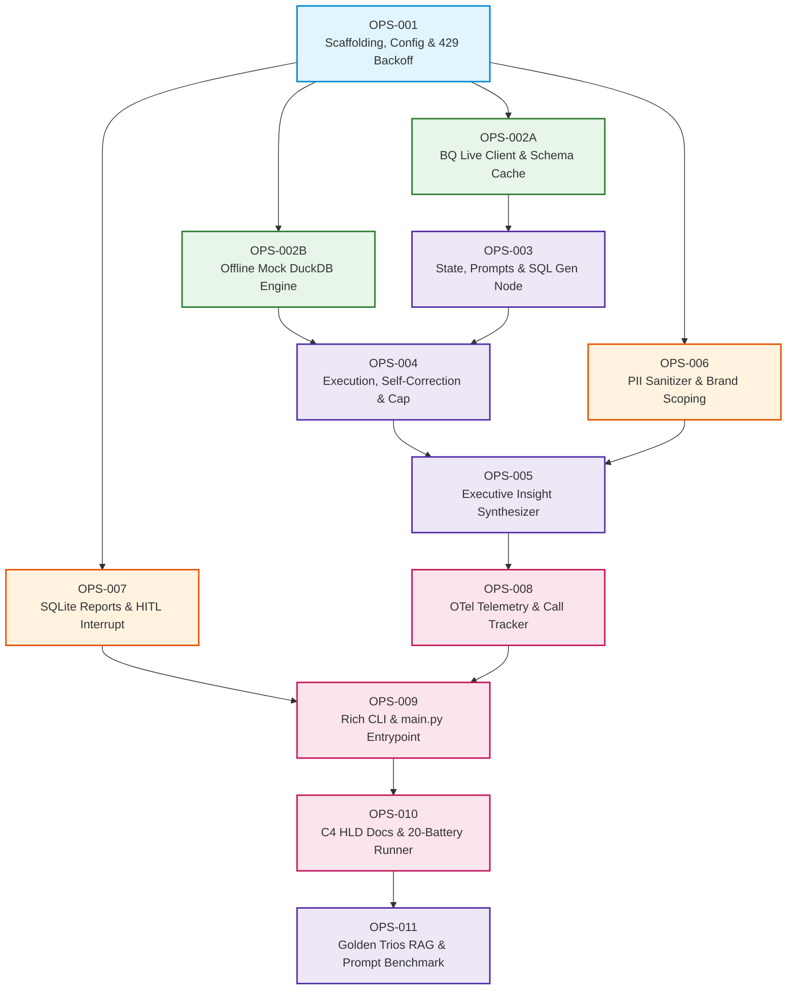

# Delivery Tickets & Sprints Index

This directory contains the user stories, acceptance criteria, and completion criteria for each atomic milestone of the **Retail Data Analysis AI Assistant**.  
Every commit and feature branch maps directly to an atomic ticket ID (`OPS-XXX`).

---

## 📋 Active Delivery Tickets Table

| Story ID | Title & Scope | Status | Branch | Priority |
|:---:|---|:---:|:---:|:---:|
| **[OPS-000](./OPS-000-foundation-and-planning.md)** | Project Foundation, Architectural Blueprints & Delivery Planning | `done` | `main` | Critical |
| **[OPS-001](./OPS-001-scaffolding-config-resilience.md)** | Repository Scaffolding, Pydantic Config & Rate-Limit Backoff | `done` | `feat/OPS-001-scaffolding` | High |
| **[OPS-002A](./OPS-002A-bigquery-live-client.md)** | BigQuery Live Client, Dynamic Schema Cache & Table Sanitizer | `done` | `feat/OPS-002A-bq-live-client` | High |
| **[OPS-002B](./OPS-002B-offline-mock-duckdb-engine.md)** | Offline Mock DuckDB Engine & Synthetic E-Commerce Fixtures | `done` | `feat/OPS-002B-mock-duckdb-engine` | High |
| **[OPS-003](./OPS-003-langgraph-state-and-sql-generator.md)** | LangGraph State Schema & GoogleSQL Generation Node | `done` | `feat/OPS-003-state-sql-gen` | Critical |
| **[OPS-004](./OPS-004-sql-execution-and-self-correction.md)** | Execution Node, Self-Correction Loop & FinOps Circuit Breaker | `done` | `feat/OPS-004-execution-self-correction` | Critical |
| **[OPS-005](./OPS-005-executive-report-synthesizer.md)** | Executive Insight & Action Item Synthesizer Node | `done` | `feat/OPS-005-report-synthesizer` | High |
| **[OPS-006](./OPS-006-enterprise-pii-and-brand-scoping.md)** | Enterprise PII Sanitizer Gate & User Brand Scoping | `done` | `main` | Critical |
| **[OPS-007](./OPS-007-saved-reports-and-hitl-interrupt.md)** | Saved Reports SQLite Storage & EU AI Act HITL Interrupt | `done` | `main` | High |
| **[OPS-008](./OPS-008-opentelemetry-genai-tracing.md)** | OpenTelemetry GenAI Telemetry & Token Accounting | `done` | `main` | Medium |
| **[OPS-009](./OPS-009-rich-cli-interface-and-main.md)** | Rich Interactive CLI Interface & Application Entrypoint (`main.py`) | `done` | `main` | High |
| **[OPS-010](./OPS-010-production-hld-and-20-battery-runner.md)** | Production HLD Document, 20-Battery Test Runner & Delivery Gate | `done` | `main` | Critical |
| **[OPS-011](./OPS-011-golden-trios-prompt-frontier.md)** | Golden Trios Knowledge Retrieval & Prompt Frontier Benchmark | `done` | `main` | High |

---

## ⚡ Execution DAG (Directed Acyclic Graph)



---

## 🛠️ Commit Message Rule
Every commit message must be linked to its corresponding story ID:
```text
OPS-XXX <type>(<scope>): <summary in imperative mood>
```
*Example:* `OPS-001 feat(config): configure requirements.txt and pydantic settings`
